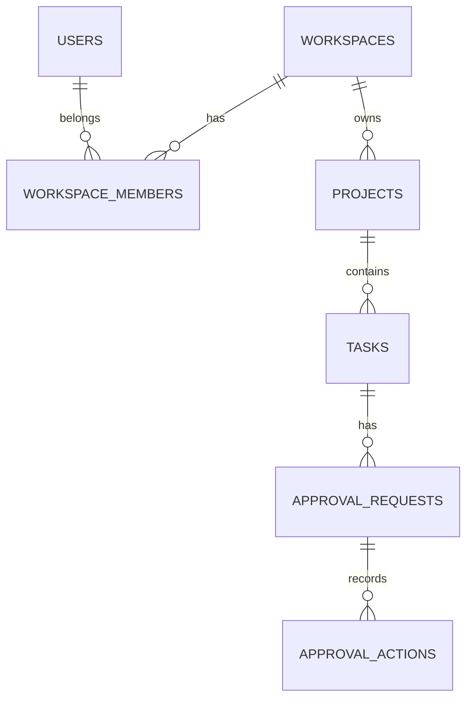

# Data Model — Preliminary

Tables beyond `app_users` are **planned only**; Flyway V1 contains the initial identity table. During M1/M2, define all FK constraints, uniqueness within workspace, soft-delete policy (if needed), indexes and auditing invariants. Never present the draft diagram as a deployed schema.
