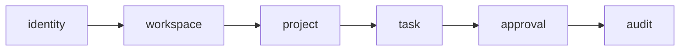

# Module Design — Draft

Proposed business modules: `identity`, `workspace`, `project`, `task`, `approval`, `audit`. Shared code is restricted to cross-cutting infrastructure, without leaking business logic.

Dependencies in this diagram are conceptual and may change during detailed design. Avoid bidirectional business-module coupling; exchange IDs or use explicit interfaces/events where warranted. Start with one Spring Boot deployable.

## Implemented foundation

The API currently contains `io.flowdesk.FlowDeskApplication` and the cross-cutting `shared.api.InfoController`. Business modules above are planned, not empty package scaffolds. The Angular app has a standalone shell and lazy `features/dashboard` component using explicit zoneless change detection. The read-only dashboard connection component uses typed HTTP and loading/error/retry states for existing info/health endpoints. Business actions remain planned.

Unit HTTP contract tests isolate the controller without a DB. Failsafe loads the complete Boot application against PostgreSQL through Testcontainers and exercises HTTP, V1 and SQL constraints. No production entity is introduced solely for testing; ORM mapping validation becomes meaningful when the first real entity is implemented.
