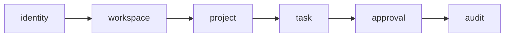

# Module Design — Draft

Proposed business modules: `identity`, `workspace`, `project`, `task`, `approval`, `audit`. Shared code is restricted to cross-cutting infrastructure, without leaking business logic.

Dependencies in this diagram are conceptual and may change during detailed design. Avoid bidirectional business-module coupling; exchange IDs or use explicit interfaces/events where warranted. Start with one Spring Boot deployable.
