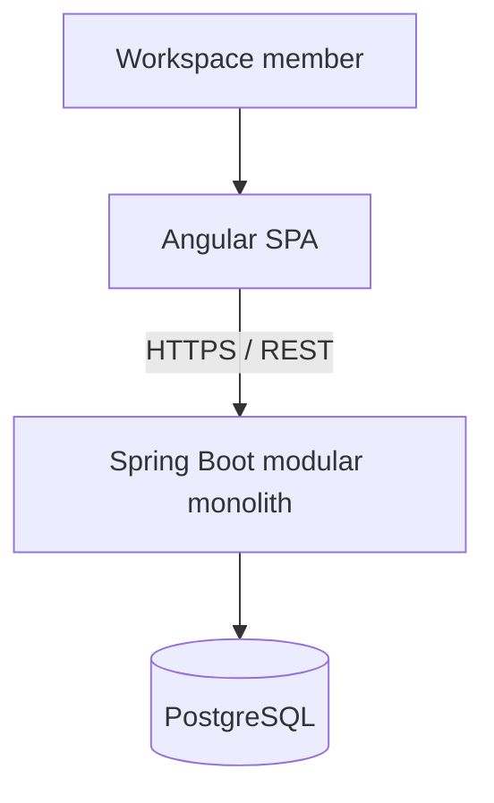

# System Context — Draft

The browser never reads the database directly. Authentication and authorization are planned for M1 and must be enforced by the API when implemented; Sprint 0 has no protected business endpoints. Redis and messaging are deferred until a measured use case justifies them.
