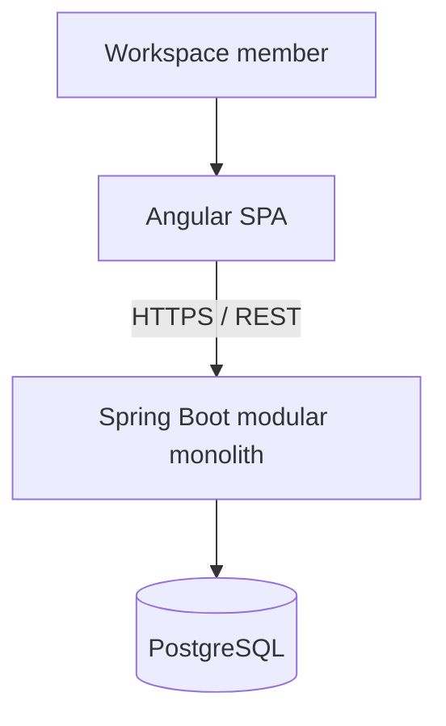

# System Context — Draft

The browser never reads the database directly. Authentication and authorization are always enforced by the API. Redis and messaging are deferred until a measured use case justifies them.
