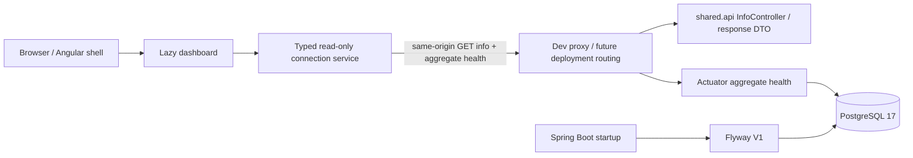

# Architecture map

Baseline main `9d723b7`, plus the explicit current connectivity increment. See [intelligence](PROJECT-INTELLIGENCE.md) and [ADR-0001](../adr/0001-modular-monolith.md).

Status service and proxy are this increment, not the baseline main implementation. The dev proxy is local tooling; production hosting must supply equivalent same-origin routes before deployment.

## Implemented boundaries

- `io.flowdesk` owns Boot bootstrap. `shared.api` owns nonbusiness info contract; no domain services/entities/repositories yet. DTO record serializes the same public JSON.
- V1 owns `app_users`; `flyway_schema_history` is managed by Flyway. JPA validation is configured but entity-free. No foreign keys, workspace schema or tenant scoping is claimed.
- `src/app/app.routes.ts` lazy-loads dashboard. Its status service owns typed HTTP decoding and bounded requests; component owns explicit signals/state and cancellation. Angular interpolation escapes displayed server strings.
- Local credentials are supplied by exported `.env`; Compose reads its own `.env`. Browser code never receives DB credentials and does not read PostgreSQL directly.

## Planned dependency direction

Future `identity`, `workspace`, `project`, `task`, `approval`, `audit` packages own their behavior. Workspace authorizes membership, downstream features consume explicit authenticated identity/workspace contracts, and audit receives append operations inside the relevant transaction. Do not interpret draft arrows as implemented package imports.

Avoid business logic in shared infrastructure, global controller/service/repository folders, circular feature imports, repository access from controllers and cross-module entity exposure. Application services should define transactions for business commands; direct shared DB access is not a substitute for module boundaries.

## Architectural readiness

Existing foundation is testable; missing Spring Security, exception contracts, transactions, reactive forms/guards/interceptors and business DTOs are expected implementation gaps, not scaffolding to add without a feature. Signals/RxJS and typed HTTP now have a concrete use. Structured security logging, metrics/tracing, deployable routing and backups remain planned. Record major changes as ADRs and evaluate real module boundaries after each vertical slice.
